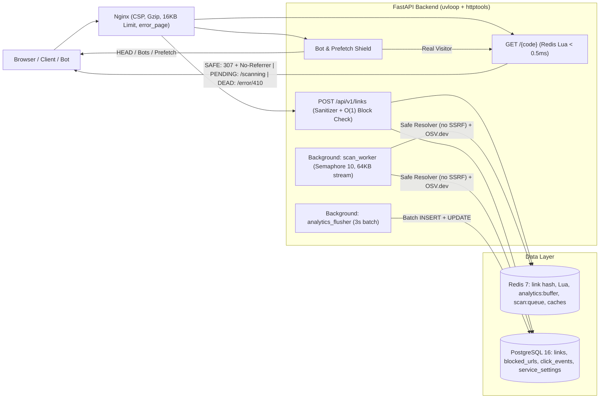

# 🔗 URL Shortener — Fast, Safe Short Links with Background CVE Screening

A high-performance, security-hardened URL shortener supporting **permanent (`Unlimited`)** and **click-limited (`Limited clicks`: 1–250)** links, **Zero-DB-Hit** redirects via Redis Lua scripts, an embedded asynchronous **CVE & Threat Scanner**, zero-overhead captcha-free security layers, and two purpose-built design systems (**Apple Liquid Glass** for public pages and **Norwegian Designsystemet** for the admin dashboard).

---

## ✨ Key Features

### 🎯 1. Flexible Link Modes
- **Unlimited**: Standard permanent, reusable short links.
- **Limited clicks (`1..250`)**: Defaults to `1` click (one-time link) with a synchronized range slider and numeric input up to `250` visits.
- **Unified Lifecycle Errors**: Once a link reaches its click limit, expires, or gets removed, subsequent visits cleanly route to **`/error/410?reason=unavailable`**.

### 🛡️ 2. Instant Issuance & Background Security Scanning
- **Zero Creation Latency**: Users receive their short link immediately in `PENDING` state while inspection runs asynchronously inside an embedded worker pool (`scan_worker`).
- **Interactive Scan Screen (`/scanning/:shortCode`)**: Opening a link before scanning completes renders a live waiting screen reading directly from Redis (0 DB hits) every `2s`, auto-redirecting as soon as it passes.
- **Strict Risk Policy**:
  - `NONE` / `LOW` (`CVSS < 4.0`) — promoted to `SAFE` and activated.
  - `MEDIUM` / `HIGH` / `CRITICAL` (`CVSS >= 4.0`), phishing URL patterns, or dangerous executable payloads — the short link is **automatically deleted**, and the destination hash is permanently added to `blocked_urls` and Redis Set `blocked:urls` (future submissions fail fast with `403 Forbidden`).
- **Two-Level Result Caching**: Host security reports are cached for **12 hours** (`scan:host:{domain}`), and software CVE lookups (built-in signatures + **OSV.dev API**) are cached for **7 days** (`cve:pkg:{product}:{ver}`).

### 🔒 3. Seamless Security Without CAPTCHAs
- **Bot & Prefetch Shield**: Intercepts `HEAD` requests, browser prefetch headers (`Purpose: prefetch`, `Sec-Purpose: prefetch`, `X-Purpose: preview`), and messenger link-preview crawlers (`TelegramBot`, `WhatsApp`, `Discordbot`, `Slackbot`, `Twitterbot`, `facebookexternalhit`, `vkShare`) **before touching Redis Lua counters** — returning a lightweight `200 OK` OpenGraph response so one-time links are never burned accidentally.
- **Zero-Cost URL Sanitizer**: In-memory microsecond validation allowing only `http://` and `https://`, enforcing length `<= 2048`, blocking embedded credentials (`user:pass@host`), stripping/blocking control chars (`CR/LF/NUL`), and detecting mixed-script IDN/Punycode homograph spoofing.
- **Safe Async Resolver (Anti-SSRF & Redirect Chain Guard)**: Validates resolved IPs via Python's `ipaddress` module on every request and across up to `5` redirect hops, blocking loopback, private networks, and cloud metadata ranges (`127.0.0.0/8`, `10.0.0.0/8`, `172.16.0.0/12`, `192.168.0.0/16`, `169.254.169.254/32`, `::1`, `fc00::/7`, `fe80::/10`).
- **Anti-Bruteforce 404/DEAD Shield**: Blocks IPs exceeding `30` misses per minute to nonexistent/dead short codes (`429 Too Many Requests` for `5` minutes).
- **Privacy by Design**: Raw IP addresses and raw `User-Agent` strings are never persisted in the database; unique click tracking uses a daily-rotating `SHA-256(IP + IP_HASH_SALT + YYYY-MM-DD)[:32]` hash.
- **Hardened Admin Authentication**: Passwords verified with **Argon2id**, JWT delivered via strict `HttpOnly; SameSite=Strict` cookies, and IP lockout (`admin:lockout`) for `15` minutes after `5` failed login attempts.

### 🎨 4. Dual Design Systems & Unified Error Handling
- **Public UI (Apple Liquid Glass)**: Ultra-minimal layout featuring a clean intro header above a translucent glass card, adaptive **Light (`#FFFFFF`) & Dark (`#090D16`)** themes via `prefers-color-scheme` plus a corner `Auto / Light / Dark` switcher.
- **Admin Dashboard (`/admin`, Norwegian Designsystemet)**: Code-split via `React.lazy()`, high-contrast data tables with `tabular-nums`, **Recharts** analytics, link controls (`Enable/Disable`, `Rescan`, inline limit editing `1..250`, delete), CVE blocked URL logs, and live service settings.
- **Unified Error Page (`ErrorPage.tsx` — `/error/:code?reason=...`)**: One parameterized component renders every error state (`403`, `404`, `410`, `413`, `422`, `429`, `500`, `503`), including Nginx proxy errors (`413`, `502`, `504`).

---

## 🧰 Tech Stack

| Layer | Technologies |
| :--- | :--- |
| **Backend** | Python 3.12, FastAPI, Uvicorn (`uvloop` + `httptools`), SQLAlchemy 2.0 (`asyncpg` / `aiosqlite`), Alembic, Pydantic Settings, `httpx` (streaming `<= 64 KB`), PyJWT, `pwdlib[argon2]`, `prometheus-fastapi-instrumentator` |
| **Frontend** | React 19, TypeScript 5, Vite 6, Tailwind CSS v4, TanStack React Query, React Router 7, Axios, Recharts, Lucide React |
| **Data & Cache** | PostgreSQL 16 (Alpine), Redis 7 (Alpine, `--maxmemory 128mb --maxmemory-policy volatile-lru`) with atomic Lua scripts and an `InMemoryRedisEngine` fallback for local dev |
| **Infrastructure** | Docker & Docker Compose, Nginx Unprivileged 1.27 (CSP, Gzip, Keepalive), Kubernetes manifests (`k8s/base` with `NetworkPolicy` & `readOnlyRootFilesystem`) |

---

## 🏗️ How It Works



1. **Create (`POST /api/v1/links`)**: The submitted URL goes through synchronous in-memory sanitization, an `O(1)` lookup in `blocked:urls`, and queue backpressure checks (`MAX_SCAN_QUEUE_SIZE`). The link is saved in PostgreSQL as `PENDING`, warmed in Redis, and queued in `scan:queue`.
2. **Background Scan (`scan_worker`)**: Concurrent scans for identical URLs are deduplicated via `scan:inflight:{url_hash}`. The worker streams up to `64 KB` of HTML while checking every hop for SSRF, fingerprints headers/meta tags, and evaluates CVE risk. Links with `CVSS >= 4.0` are deleted from `links` and permanently stored in `blocked_urls`.
3. **Hot Redirect (`GET /{short_code}`)**: Requests pass through `Bot & Prefetch Shield`, then hit a single atomic Redis Lua script (`< 0.5 ms`) that verifies scan status (`PENDING` / `SAFE` / `DEAD`), decrements `remaining` on limited links, sets a `DEAD` tombstone upon exhaustion, and pushes a compact analytics payload into `analytics:buffer`.
4. **Write-Behind Analytics (`analytics_flusher`)**: Every `3` seconds (or up to `500` records per batch), queued click events are flushed to PostgreSQL in one transaction (`click_events` batch insert + aggregated click count update on `links`).

---

## 📁 Project Structure

```text
url-shortener/
├── .env.example                 # Environment variable template
├── .gitignore                   # Git exclusions (.env, *.db, .venv, node_modules, dist, PLAN.md)
├── docker-compose.yml           # Production stack: postgres, redis, migrate, backend, frontend
├── backend/
│   ├── Dockerfile               # Multi-stage Python 3.12-slim build (non-root)
│   ├── alembic/                 # Database migrations and partial/covering indexes
│   ├── app/
│   │   ├── api/                 # links, redirect, auth, admin, health, error_utils
│   │   ├── core/                # config, url_security, ssrf_guard, bot_shield, security, rate_limit, shortener
│   │   ├── db/                  # session (SQLAlchemy Async), redis (Lua + InMemory fallback)
│   │   ├── models/              # Link, BlockedUrl, ClickEvent, ServiceSettings
│   │   ├── services/            # scanner, analytics, settings_service, admin
│   │   └── workers/             # scan_worker, analytics_flusher
│   └── tests/                   # Pytest integration & unit suite (7 core scenarios)
├── frontend/
│   ├── Dockerfile               # Node 22 build -> nginx-unprivileged:1.27-alpine
│   ├── public/favicon.svg       # Browser tab icon
│   └── src/
│       ├── api/                 # Axios client with cookies & error interceptor
│       ├── components/          # ThemeToggle, ProtectedRoute, ErrorBoundary
│       ├── hooks/               # useTheme (Light/Dark OS sync), React Query hooks
│       ├── pages/               # Home, ScanningWait, ErrorPage, LinkStats, AdminLogin, AdminDashboard
│       └── styles/              # liquid-glass.css (Apple Liquid Glass) + designsystemet.css
├── infra/nginx/default.conf     # Nginx reverse proxy config (CSP, routing, unified error_page)
└── k8s/                         # Kubernetes manifests (base 00..09 + NetworkPolicy)
```

---

## 🚀 Deploying on Your Server

### 🐳 Option 1: Docker Compose (Recommended for Production VPS)

**Prerequisites**: Linux server (Ubuntu/Debian), `Docker`, `Docker Compose` (`docker compose version`), and `openssl`.

#### 1. Clone the repository and create `.env`
```bash
git clone https://github.com/emmph/url-shortener.git
cd url-shortener
cp .env.example .env
```

#### 2. Generate production secrets and an Argon2id admin password hash
Generate strong random hex keys for `JWT_SECRET_KEY`, `IP_HASH_SALT`, and `POSTGRES_PASSWORD`:
```bash
openssl rand -hex 32
```

Generate an **Argon2id** hash for your admin password (replace `YOUR_STRONG_PASSWORD`):
```bash
docker run --rm python:3.12-slim sh -c \
  "pip install -q 'pwdlib[argon2]' && python -c 'from pwdlib import PasswordHash; print(PasswordHash.recommended().hash(\"YOUR_STRONG_PASSWORD\"))'"
```

#### 3. Configure `.env`
Edit `.env` with your production values:
```dotenv
POSTGRES_PASSWORD=<generated_postgres_password>
DATABASE_URL=postgresql+asyncpg://url_shortener:<generated_postgres_password>@postgres:5432/url_shortener

BASE_URL=https://your-domain.com
ENVIRONMENT=production
COOKIE_SECURE=true

IP_HASH_SALT=<random_hex_salt>
JWT_SECRET_KEY=<random_hex_key_at_least_32_bytes>

ADMIN_USERNAME=admin
ADMIN_PASSWORD=
ADMIN_PASSWORD_HASH=<generated_argon2id_hash>

ALLOW_MEMORY_FALLBACK=false
SERVE_FRONTEND_DIST=false
```
> **Note**: Set `COOKIE_SECURE=true` when serving over HTTPS. If testing over plain HTTP (`http://SERVER_IP:8080`), set `COOKIE_SECURE=false` so browser admin cookies can be stored.

#### 4. Build and start the stack
```bash
docker compose up -d --build
```
The `migrate` container automatically runs `alembic upgrade head`, after which `backend` (with embedded workers) and `frontend` (`nginx-unprivileged` on port `8080`) start cleanly.

Verify health and readiness:
```bash
docker compose ps
curl -s http://127.0.0.1:8080/readyz
# Expected output: {"status":"ready","database":"up","redis":"up"}
```

#### 5. Attach a custom domain & HTTPS
Place a TLS-terminating reverse proxy in front of `127.0.0.1:8080`. Example using **Caddy** (`/etc/caddy/Caddyfile`):
```text
your-domain.com {
    reverse_proxy 127.0.0.1:8080
}
```
Reload Caddy — your public site will be live at `https://your-domain.com` and the admin dashboard at `https://your-domain.com/admin/login`.

---

### ☸️ Option 2: Kubernetes

1. Update secrets and domain configuration inside `k8s/base/01-configmap.yaml`, `k8s/base/02-secrets.yaml`, and `k8s/base/08-ingress.yaml`.
2. Apply the manifests:
```bash
kubectl apply -f k8s/base/
kubectl -n url-shortener get pods
```
`09-network-policy.yaml` isolates `postgres` and `redis` access strictly to `backend` pods and blocks outbound scanner traffic toward private or metadata CIDR blocks.

---

### 💻 Option 3: Local Development (No Docker Required)

For local development, the backend supports SQLite (`aiosqlite`) paired with `InMemoryRedisEngine` (`ALLOW_MEMORY_FALLBACK=true`), and can serve `frontend/dist` directly (`SERVE_FRONTEND_DIST=true`).

1. **Build Frontend**:
```bash
cd frontend
npm install
npm run build
```

2. **Start Backend**:
```bash
cd backend
python3 -m venv .venv
source .venv/bin/activate
pip install -r requirements.txt
alembic upgrade head
uvicorn app.main:app --host 127.0.0.1 --port 8000
```
*(Optional)* Run `npm run dev` inside `frontend/` on port `5173` for Vite HMR proxying API calls to `:8000`.

3. **Run Test Suite**:
```bash
cd backend
.venv/bin/pytest -v
```

---

## 📡 Core API Endpoints

| Method & Path | Description |
| :--- | :--- |
| `POST /api/v1/links` | Create a short link (`original_url`, `max_clicks`: `null` or `1..250`) |
| `GET` / `HEAD /{short_code}` | Safe redirect (`307`), bot preview stub (`200`), `/scanning/:code`, or `/error/410` |
| `GET /api/v1/links/{code}/scan-status` | Live scan progress and ETA (served exclusively from Redis) |
| `GET /api/v1/links/{code}/stats` | Click metrics, timeseries, devices, and browsers breakdown |
| `POST /api/v1/admin/login` | Admin sign-in (sets `HttpOnly` JWT Cookie) |
| `GET /api/v1/admin/overview` | Global KPI metrics, 7-day chart data, and queue/Redis status |
| `GET/PATCH/DELETE /api/v1/admin/links...` | Search, filter, toggle active status, edit click limit, rescan, or delete |
| `GET/DELETE /api/v1/admin/blocked-urls...` | Inspect CVE reports and unblock domains/URLs |
| `GET/PUT /api/v1/admin/settings` | Live updates for rate limits, CVSS block threshold, and domain blacklist |
| `GET /healthz`, `GET /readyz`, `GET /metrics` | Liveness/readiness probes and Prometheus metrics |
