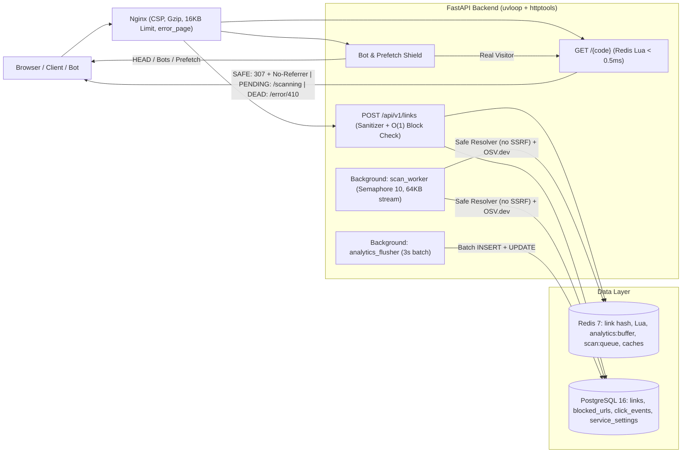

# URL Shortener — Fast, Safe Short Links with Background CVE Screening

Высокопроизводительный сервис сокращения ссылок с поддержкой **постоянных (`Unlimited`)** и **лимитированных (`Limited clicks`: 1–250)** ссылок, **Zero-DB-Hit** редиректами через Redis Lua-скрипты, встроенным асинхронным сканером уязвимостей (CVE / SSRF / фишинг), невидимой защитой без капч и двумя специализированными дизайн-системами (**Apple Liquid Glass** для публичного интерфейса и **Norwegian Designsystemet** для админ-панели).

---

## Ключевые возможности

### 1. Два режима сокращения ссылок
- **Unlimited**: классическая постоянная многоразовая ссылка.
- **Limited clicks (`1..250`)**: по умолчанию `1` переход (одноразовая ссылка) с синхронным ползунком и полем ручного ввода до `250` кликов.
- По достижении лимита переходов, при удалении ссылки или истечении срока действия открывается единая информативная страница **`/error/410?reason=unavailable`**.

### 2. Мгновенная выдача и фоновая проверка безопасности (CVE & Threats)
- **Без задержек при создании**: пользователь сразу получает короткий URL в статусе `PENDING`, а проверка запускается асинхронно в фоновом пуле (`scan_worker`).
- **Экран ожидания (`/scanning/:shortCode`)**: если перейти по ссылке до завершения сканирования, отображается прогресс и ориентировочное время до открытия (автоопрос Redis без обращений к БД каждые `2s` с автоматическим редиректом по завершении).
- **Строгая политика вердиктов**:
  - `NONE` / `LOW` (`CVSS < 4.0`) — ссылка переходит в `SAFE` и начинает работать.
  - `MEDIUM` / `HIGH` / `CRITICAL` (`CVSS >= 4.0`), фишинговые шаблоны или опасные исполняемые файлы — короткая ссылка **удаляется**, а исходный URL навсегда заносится в таблицу `blocked_urls` и Redis Set `blocked:urls` (повторное сокращение блокируется с кодом `403`).
- **Кэширование результатов**: доменные проверки кэшируются на **12 часов** (`scan:host:{domain}`), а запросы CVE для версий ПО — на **7 дней** (`cve:pkg:{product}:{ver}`). Опрашиваются встроенная база сигнатур CVE и API **OSV.dev**.

### 3. Многоуровневая безопасность без капч (`Zero-Overhead Security`)
- **Bot & Prefetch Shield**: запросы `HEAD`, заголовки предзагрузки (`Purpose: prefetch`, `Sec-Purpose: prefetch`, `X-Purpose: preview`) и превью-боты мессенджеров (`TelegramBot`, `WhatsApp`, `Discordbot`, `Slackbot`, `Twitterbot`, `facebookexternalhit`, `vkShare`) получают нейтральный `200 OK` HTML с OpenGraph-тегами **до обращения к счётчику** — лимит одноразовых ссылок не сжигается.
- **Zero-Cost URL Sanitizer**: мгновенная проверка в памяти схем (`http://` и `https://` только), длины (`<= 2048`), запрета учётных данных (`user:pass@host`), управляющих символов (`CR/LF/NUL`) и IDN/Punycode-гомографов (смешение латиницы и кириллицы/греческого).
- **Safe Async Resolver (Anti-SSRF & Redirect Chain Guard)**: перед подключением и на каждом из до `5` хопов редиректа проверяет IP-адреса через `ipaddress` и блокирует loopback, приватные подсети и cloud-metadata (`127.0.0.0/8`, `10.0.0.0/8`, `172.16.0.0/12`, `192.168.0.0/16`, `169.254.169.254/32`, `::1`, `fc00::/7`, `fe80::/10`).
- **Anti-Bruteforce 404/DEAD Shield**: более `30` обращений в минуту к несуществующим или мёртвым кодам с одного суточного `ip_hash` временно блокируются (`429 Too Many Requests` на `5` минут).
- **Privacy by Design**: сырые IP-адреса и строки `User-Agent` не сохраняются в БД; для уникальных кликов используется суточно-ротируемый хеш `SHA-256(IP + IP_HASH_SALT + YYYY-MM-DD)[:32]`.
- **Защита админ-панели**: хеширование пароля **Argon2id**, JWT в `HttpOnly; SameSite=Strict` cookie и блокировка IP (`admin:lockout`) после `5` неверных попыток входа на `15` минут.

### 4. Дизайн-система и единая обработка ошибок
- **Публичный UI (Apple Liquid Glass)**: чистый минимализм (краткий заголовок и описание сервиса над стеклянной карточкой, переключатель режимов, расширенное поле ввода URL и кнопка `Shorten`), автоматическая светлая (`#FFFFFF`) и тёмная (`#090D16`) тема по `prefers-color-scheme` + переключатель `Auto / Light / Dark`.
- **Админ-панель (`/admin`, Norwegian Designsystemet)**: ленивая загрузка (`React.lazy()`), чёткие таблицы (`tabular-nums`), графики `Recharts`, управление ссылками (`Enable/Disable`, `Rescan`, редактирование лимита `1..250`, удаление), журнал заблокированных CVE-адресов и динамические настройки.
- **Единый шаблон ошибок (`ErrorPage.tsx` — `/error/:code?reason=...`)**: один универсальный компонент обслуживает все HTTP-коды (`403`, `404`, `410`, `413`, `422`, `429`, `500`, `503`), включая ошибки уровня Nginx (`413`, `502`, `504`).

---

## Технологический стек

| Слой | Технологии |
| :--- | :--- |
| **Backend** | Python 3.12, FastAPI, Uvicorn (`uvloop` + `httptools`), SQLAlchemy 2.0 (`asyncpg` / `aiosqlite`), Alembic, Pydantic Settings, `httpx` (streaming <= `64 KB`), PyJWT, `pwdlib[argon2]`, `prometheus-fastapi-instrumentator` |
| **Frontend** | React 19, TypeScript 5, Vite 6, Tailwind CSS v4, TanStack React Query, React Router 7, Axios, Recharts, Lucide React |
| **БД и Кэш** | PostgreSQL 16 (Alpine), Redis 7 (Alpine, `--maxmemory 128mb --maxmemory-policy volatile-lru`) с Lua-скриптами и fallback `InMemoryRedisEngine` для локальной разработки |
| **Инфраструктура** | Docker & Docker Compose, Nginx Unprivileged 1.27 (CSP, Gzip, Keepalive), Kubernetes манифесты (`k8s/base` с `NetworkPolicy` и `readOnlyRootFilesystem`) |

---

## Как всё устроено и работает



1. **Создание (`POST /api/v1/links`)**: URL проходит синхронную санитизацию в памяти, `O(1)` проверку в `blocked:urls` и проверку глубины очереди (`MAX_SCAN_QUEUE_SIZE`). Запись сохраняется в PostgreSQL со статусом `PENDING`, прогревается хеш в Redis и задача уходит в `scan:queue`.
2. **Асинхронное сканирование (`scan_worker`)**: воркер дедуплицирует одновременные проверки одного URL (`scan:inflight:{url_hash}`), потоково загружает до `64 KB` HTML с проверкой каждого IP на SSRF, извлекает заголовки/сигнатуры и оценивает CVE-риск. При `CVSS >= 4.0` удаляет ссылку из `links` и переносит хеш в `blocked_urls`.
3. **Горячий редирект (`GET /{short_code}`)**: после `Bot & Prefetch Shield` выполняется один Lua-скрипт в Redis (`< 0.5 мс`), который проверяет статус (`PENDING` / `SAFE` / `DEAD`), атомарно списывает `remaining` (для лимитированных ссылок), ставит tombstone `DEAD` при исчерпании и кладёт компактное событие в `analytics:buffer`.
4. **Пакетный сброс (`analytics_flusher`)**: каждые `3` секунды (пачками до `500` записей) события одной транзакцией пишутся в PostgreSQL (`click_events` + обновление счётчика в `links`).

---

## Структура проекта

```text
url-shortener/
├── .env.example                 # Шаблон переменных окружения
├── .gitignore                   # Исключения для Git (.env, *.db, .venv, node_modules, dist)
├── docker-compose.yml           # Production-стек: postgres, redis, migrate, backend, frontend
├── backend/
│   ├── Dockerfile               # Multi-stage сборка Python 3.12-slim (non-root)
│   ├── alembic/                 # Миграции схемы БД и индексов
│   ├── app/
│   │   ├── api/                 # links, redirect, auth, admin, health, error_utils
│   │   ├── core/                # config, url_security, ssrf_guard, bot_shield, security, rate_limit, shortener
│   │   ├── db/                  # session (SQLAlchemy Async), redis (Lua + InMemory fallback)
│   │   ├── models/              # Link, BlockedUrl, ClickEvent, ServiceSettings
│   │   ├── services/            # scanner, analytics, settings_service, admin
│   │   └── workers/             # scan_worker, analytics_flusher
│   └── tests/                   # Pytest набор (7 интеграционных и unit-сценариев)
├── frontend/
│   ├── Dockerfile               # Node 22 build -> nginx-unprivileged:1.27-alpine
│   ├── public/favicon.svg       # Иконка вкладки браузера
│   └── src/
│       ├── api/                 # Axios-клиент с interceptor ошибок и cookies
│       ├── components/          # ThemeToggle, ProtectedRoute, ErrorBoundary
│       ├── hooks/               # useTheme (Light/Dark OS sync), React Query хуки
│       ├── pages/               # Home, ScanningWait, ErrorPage, LinkStats, AdminLogin, AdminDashboard
│       └── styles/              # liquid-glass.css (Apple Liquid Glass) + designsystemet.css
├── infra/nginx/default.conf     # Конфигурация Nginx (CSP, проксирование, единые error_page)
└── k8s/                         # Kubernetes манифесты (base 00..09 + NetworkPolicy)
```

---

## Запуск сервиса на сервере

### Способ 1: Docker Compose (Рекомендуется для Production VPS)

**Требования**: Linux-сервер (Ubuntu/Debian), установленные `Docker` и `Docker Compose` (`docker compose version`), а также `openssl`.

#### 1. Клонируйте репозиторий и создайте `.env`
```bash
git clone <URL_ВАШЕГО_РЕПОЗИТОРИЯ> url-shortener
cd url-shortener
cp .env.example .env
```

#### 2. Сгенерируйте боевые секреты и хеш пароля администратора
Сгенерируйте случайные строки для `JWT_SECRET_KEY`, `IP_HASH_SALT` и `POSTGRES_PASSWORD`:
```bash
openssl rand -hex 32
```

Сгенерируйте `Argon2id`-хеш вашего пароля администратора (замените `YOUR_STRONG_PASSWORD`):
```bash
docker run --rm python:3.12-slim sh -c \
  "pip install -q 'pwdlib[argon2]' && python -c 'from pwdlib import PasswordHash; print(PasswordHash.recommended().hash(\"YOUR_STRONG_PASSWORD\"))'"
```

#### 3. Отредактируйте `.env`
Откройте `.env` и задайте боевые значения:
```dotenv
POSTGRES_PASSWORD=<сгенерированный_пароль_postgres>
DATABASE_URL=postgresql+asyncpg://url_shortener:<сгенерированный_пароль_postgres>@postgres:5432/url_shortener

BASE_URL=https://your-domain.com
ENVIRONMENT=production
COOKIE_SECURE=true

IP_HASH_SALT=<случайная_строка_hex>
JWT_SECRET_KEY=<случайная_строка_hex_не_менее_32_байт>

ADMIN_USERNAME=admin
ADMIN_PASSWORD=
ADMIN_PASSWORD_HASH=<полученный_argon2id_хеш>

ALLOW_MEMORY_FALLBACK=false
SERVE_FRONTEND_DIST=false
```
> Примечание: при работе за HTTPS обязательно установите `COOKIE_SECURE=true`, а при тестировании по чистому HTTP без TLS (`http://IP:8080`) оставьте `COOKIE_SECURE=false`.

#### 4. Соберите и запустите контейнеры
```bash
docker compose up -d --build
```
Сервис `migrate` автоматически применит миграции PostgreSQL (`alembic upgrade head`), после чего поднимутся `backend` (с встроенными воркерами) и `frontend` (`nginx-unprivileged` на порту `8080`).

Проверьте состояние и готовность:
```bash
docker compose ps
curl -s http://127.0.0.1:8080/readyz
# Ожидаемый ответ: {"status":"ready","database":"up","redis":"up"}
```

#### 5. Подключите домен и HTTPS (Reverse Proxy)
Поставьте перед портом `127.0.0.1:8080` ваш обратный прокси для автоматического TLS (Let's Encrypt). Например, в **Caddy** (`/etc/caddy/Caddyfile`):
```text
your-domain.com {
    reverse_proxy 127.0.0.1:8080
}
```
После перезагрузки Caddy сервис доступен на `https://your-domain.com`, а панель администратора — на `https://your-domain.com/admin/login`.

---

### Способ 2: Kubernetes

1. Заполните боевые секреты и домен в `k8s/base/01-configmap.yaml`, `k8s/base/02-secrets.yaml` и `k8s/base/08-ingress.yaml`.
2. Примените манифесты:
```bash
kubectl apply -f k8s/base/
kubectl -n url-shortener get pods
```
Манифест `09-network-policy.yaml` изолирует `postgres` и `redis` только для подов `backend` и блокирует исходящий трафик сканера во внутренние подсети кластера.

---

### Способ 3: Локальный запуск для разработки (без Docker)

В dev-режиме бэкенд может работать на SQLite (`aiosqlite`) и встроенном `InMemoryRedisEngine` (`ALLOW_MEMORY_FALLBACK=true`), одновременно раздавая собранный `frontend/dist` (`SERVE_FRONTEND_DIST=true`).

1. **Frontend**:
```bash
cd frontend
npm install
npm run build
```

2. **Backend**:
```bash
cd backend
python3 -m venv .venv
source .venv/bin/activate
pip install -r requirements.txt
alembic upgrade head
uvicorn app.main:app --host 127.0.0.1 --port 8000
```
Для hot-reload фронтенда параллельно можно запустить `npm run dev` в `frontend/` (порт `5173`, прокси на `:8000`).

3. **Запуск тестов**:
```bash
cd backend
.venv/bin/pytest -v
```

---

## Ключевые API-эндпоинты

| Метод и путь | Назначение |
| :--- | :--- |
| `POST /api/v1/links` | Создание ссылки (`original_url`, `max_clicks`: `null` или `1..250`) |
| `GET` / `HEAD /{short_code}` | Защищённый редирект (`307`), бот-заглушка (`200`), экран ожидания (`/scanning/:code`) или `/error/410` |
| `GET /api/v1/links/{code}/scan-status` | Прогресс и ETA фоновой CVE-проверки (читается только из Redis) |
| `GET /api/v1/links/{code}/stats` | Детальная статистика кликов, устройств и браузеров |
| `POST /api/v1/admin/login` | Вход администратора (установка `HttpOnly` JWT Cookie) |
| `GET /api/v1/admin/overview` | Глобальная аналитика и состояние Redis/очередей |
| `GET/PATCH/DELETE /api/v1/admin/links...` | Управление ссылками, лимитами и принудительное пересканирование (`rescan`) |
| `GET/DELETE /api/v1/admin/blocked-urls...` | Просмотр CVE-отчётов и разблокировка URL |
| `GET/PUT /api/v1/admin/settings` | Динамическое изменение лимитов, порога CVSS и чёрного списка доменов |
| `GET /healthz`, `GET /readyz`, `GET /metrics` | Health-пробы и метрики Prometheus |
